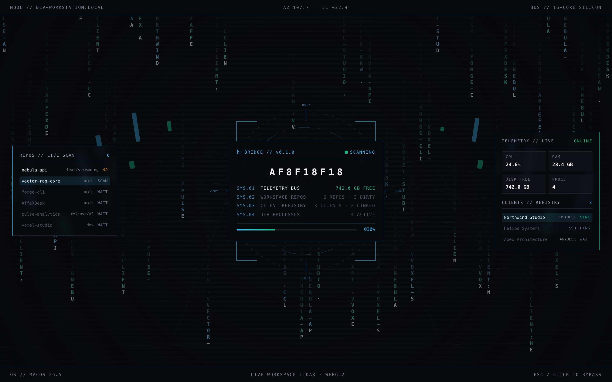
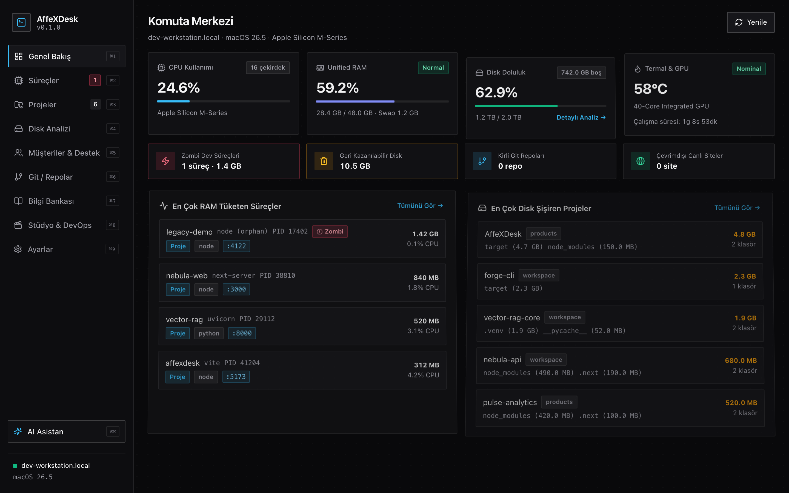
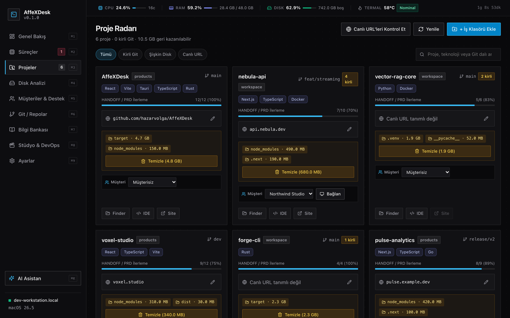
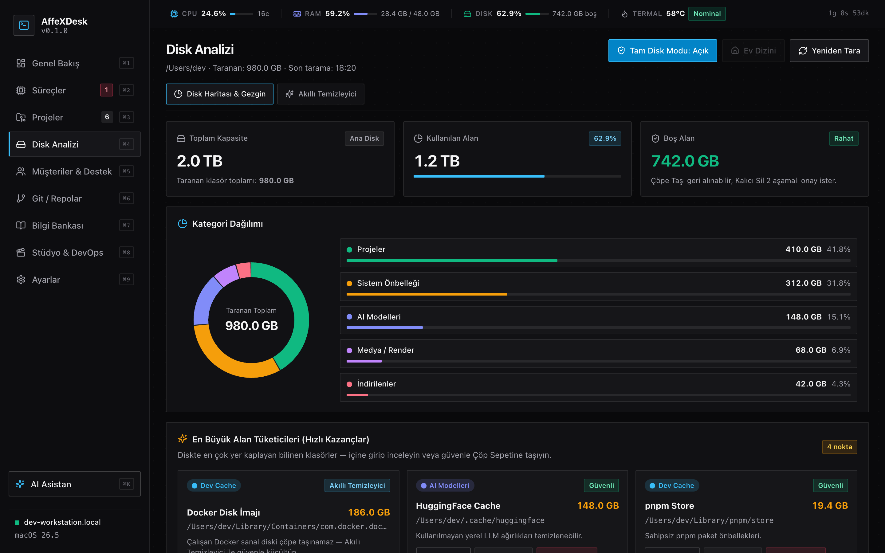
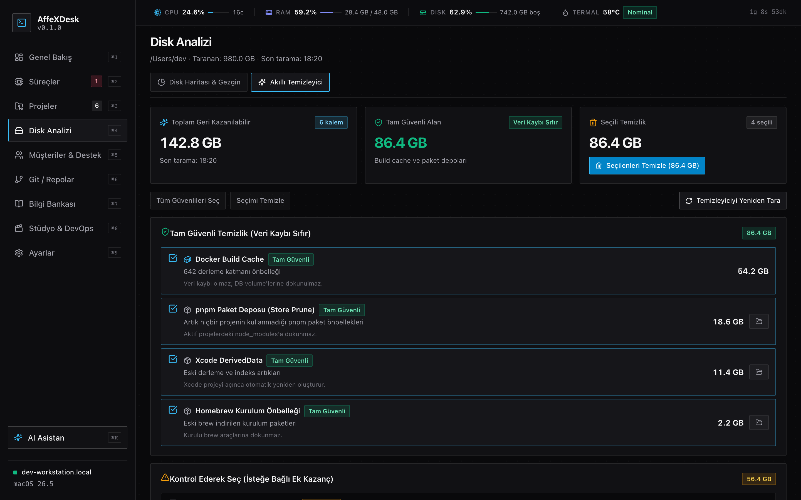
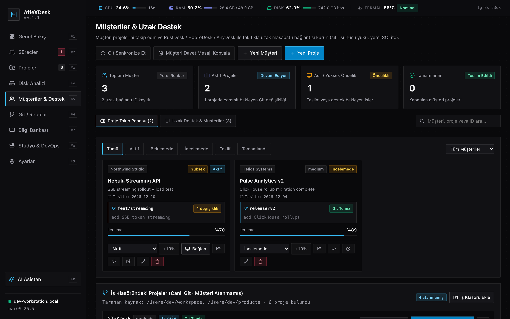

# AffeXDesk

[English](./README.md) · **Türkçe**

**Açık Kaynak Geliştirici & Kurucu Komuta Merkezi** — **Tauri 2**, **Rust**, **React 19**, **TypeScript**, **Three.js (WebGL2)**, **GSAP** ve yerel **SQLite** ile geliştirildi.

[](./LICENSE)
[](https://v2.tauri.app/)
[](https://www.rust-lang.org/)
[](https://react.dev/)
[](#kurulum-ve-geliştirme)

> Bulut bağımlılığı sıfır. Sabit kodlanmış kişisel yol sıfır. Cihaz dışına giden telemetri sıfır.  
> Her şey sıkı güvenlik korumaları ve keskin, düz koyu grafit arayüzle tamamen bilgisayarınızda yerel çalışır.

<p align="center">
  
</p>

## Görsel Tur

<table>
  <tr>
    <td width="50%">
      
      <p align="center"><strong>Komuta Merkezi (Genel Bakış)</strong> — Canlı CPU, RAM, Disk, Termal, Zombi Süreçler ve Geri Kazanılabilir Alanlar</p>
    </td>
    <td width="50%">
      
      <p align="center"><strong>Proje Merkezi</strong> — Çoklu teknoloji tespiti, Git durumu, canlı site uptime kontrolü ve Finder'da açılabilir önbellek etiketleri</p>
    </td>
  </tr>
  <tr>
    <td width="50%">
      
      <p align="center"><strong>Görsel Disk Analizi</strong> — Paralel klasör tarayıcı, SVG kategori grafiği ve Hızlı Kazançlar</p>
    </td>
    <td width="50%">
      
      <p align="center"><strong>Akıllı Sistem Temizleyici</strong> — Docker, pnpm, npm, pip, uv, Homebrew ve Xcode için güvenli tek tık temizlik</p>
    </td>
  </tr>
  <tr>
    <td colspan="2" align="center">
      
      <p align="center"><strong>Müşteriler & Sunucusuz Uzak Destek</strong> — Yerel SQLite CRM ve tek tık RustDesk, AnyDesk, VNC, RDP, SSH başlatıcı</p>
    </td>
  </tr>
</table>

---

## Neden AffeXDesk?

Geliştiriciler ve bağımsız kurucular onlarca yerel repoyu, arkada unutulmuş zombi geliştirme sunucularını, yüzlerce GB'lık gizli önbellekleri (`Docker.raw`, `node_modules`, Rust `target/`, HuggingFace / MLX model ağırlıkları), müşteri uzak destek kimliklerini ve yerel AI araçlarını dağınık terminal pencereleri arasında yönetmek zorunda kalıyor.

**AffeXDesk**, tüm bunları yalnızca **18 MB'lık doğal (native) bir masaüstü komuta merkezinde** birleştirir:

### Temel Modüller

- **Canlı Donanım Telemetrisi & Süreç Kontrolü (`⌘1` / `⌘2`)**
  - Tüm alt sayfalarda sabit üst şeritte canlı CPU, RAM baskısı, disk doluluğu, termal durum ve çalışma süresi.
  - Port tespiti (`lsof` / `netstat`), zombi süreç işaretleme ve korumalı PID kilidiyle güvenli süreç sonlandırma.
- **Çalışma Alanı & Proje Merkezi (`⌘3`)**
  - JS/TS, Rust/Tauri, Python, Go, Java, PHP, Flutter, Swift ve Docker projelerini otomatik tarar.
  - Canlı Git branch, kirli dosya sayısı, son commit, canlı URL sağlık kontrolü ve **yalnızca güvenli önbellek klasörleri** (`node_modules`, `target`, `.next`, `dist`, `.venv`, `__pycache__`) için tek tık temizlik + her klasör etiketinden doğrudan Finder'da açma.
- **Görsel Disk Analizi & Akıllı Sistem Temizleyici (`⌘4`)**
  - Çok iş parçacıklı paralel disk taraması, etkileşimli SVG kategori grafiği, alt klasör gezgini, Hızlı Kazançlar ve macOS Tam Disk Modu.
  - **Akıllı Sistem Temizleyici:** Docker Build Cache, kullanılmayan imajlar, `pnpm store prune`, `npm`, `pip`, `uv`, `brew cleanup --prune=all -s`, Xcode DerivedData, eski güncelleyici kalıntıları, Playwright tarayıcıları ve tarayıcı önbellekleri için kalem bazlı boyut raporu ve Docker konteyner/volume çakışma kilidi.
  - **Yerel AI Model Yöneticisi:** HuggingFace, MLX-Serve ve LM Studio ağırlıklarını tarar; `Aktif`, `Kullanılmıyor` ve `Yarım Kalıntı` olarak sınıflandırır, 2 aşamalı kalıcı silme onayı sunar.
- **Müşteriler & Sunucusuz Uzak Destek (`⌘5`)**
  - Yerel SQLite CRM (`clients` & `client_projects`, `ON DELETE CASCADE`) ve çalışma alanı projeleriyle çift yönlü senkronizasyon.
  - **RustDesk**, **HopToDesk**, **AnyDesk**, **VNC**, **RDP** ve **SSH** için tek tık yerel URI başlatıcı ve kopyalanabilir müşteri davet şablonları.
- **Git / Repolar, Bilgi Bankası & Stüdyo DevOps (`⌘6`–`⌘8`)**
  - Yerel proje oluşturma, GitHub/GitLab entegrasyonu (maskelenmiş IPC tokenları), yerel bilgi bankası arama, `.env` gizli anahtar hijyen tarayıcısı, Docker konteyner yönetimi ve yaratıcı medya önbellek kontrolü.
- **Taktik Lidar Açılış HUD & GSAP Koreografisi (`Three.js WebGL2 + GSAP`)**
  - Arka plandaki gerçek taramalar tamamlanırken çalışan 3B WebGL2 GLSL Lidar ızgarası ve gerçek proje/müşteri isimlerinizle akan canlı Matrix veri yağmuru (tıklayarak veya `ESC` ile anında geçilebilir; kapandığında WebGL belleği tamamen temizlenir).
- **Yerel AI Asistan Çekmecesi (`⌘K`)**
  - OpenAI uyumlu herhangi bir yerel sunucuya (MLX-Serve, Ollama, LM Studio) bağlanır; çevrimdışı yedek aksiyon desteği sunar.

---

## Güvenlik ve Veri Koruma Mimarisi

- **Korumalı Yol Kilidi:** İşletim sistemi kök dizinleri, kullanıcı ana klasörleri (`Desktop`, `Documents`, `Library`, `dev`, `.ssh`, `.gnupg`, `com.docker.docker`, `/opt/homebrew`), symlink'ler ve `.git` klasörleri silme işlemlerinden donanımsal olarak korunur.
- **Allowlist Proje Temizliği:** Proje kartlarındaki temizleme yalnızca yeniden üretilebilir derleme/bağımlılık klasörlerini (`node_modules`, `target`, `.next`, `dist`, `.turbo`, `.venv`, `venv`, `__pycache__`, `.pytest_cache`) hedefler.
- **2 Aşamalı Kalıcı Silme:** Geri alınamaz silme işlemleri her adımda "Vazgeç" butonuna odaklanan iki aşamalı onay penceresi gerektirir.
- **Sertleştirilmiş Yerel SQLite:** WAL modu, sürüm takipli migrasyonlar (`PRAGMA user_version`) ve migrasyon öncesi otomatik yedek, Unix `0600` dosya izinleri ve maskelenmiş token aktarımı (`__CONFIGURED__`).
- **Sıkı CSP:** [tauri.conf.json](./src-tauri/tauri.conf.json) içinde yapılandırılmış sıkı İçerik Güvenlik Politikası.

---

## Klavye Kısayolları

| Kısayol | İşlev |
| :--- | :--- |
| `⌘1` – `⌘9` *(veya `Alt+1`–`9`)* | Genel Bakış, Süreçler, Projeler, Disk Analizi, Müşteriler, Git, Bilgi Bankası, Stüdyo ve Ayarlar arasında geçiş |
| `⌘K` *(veya `Ctrl+K`)* | AI Asistan Çekmecesini aç/kapat |
| `ESC` | Aktif pencereyi kapat / Açılış HUD'ını atla |

---

## Kurulum ve Geliştirme

### Gereksinimler

- **Node.js** `v20+`
- **Rust** (`rustup` ile kararlı sürüm)
- [Tauri 2](https://v2.tauri.app/start/prerequisites/) platform önkoşulları

### Yerel Çalıştırma

```bash
git clone https://github.com/hazarvolga/AffeXDesk.git
cd AffeXDesk
npm install
npm run tauri dev
```

### Üretim Paketi Derleme

```bash
npm run tauri build
```

### Doğrulama ve Test Paketi

```bash
# TypeScript ve React bileşen testleri (Vitest)
npx tsc --noEmit
CI=true npm test

# Rust statik analiz ve birim testleri (53 test)
cd src-tauri
cargo clippy --all-targets -- -D warnings
cargo test
```

---

## Katkı ve Güvenlik

- Katkılarınızı bekliyoruz! Pull request açmadan önce [CONTRIBUTING.md](./CONTRIBUTING.md) dosyasını inceleyin.
- Bir güvenlik açığı bildirmek için lütfen [SECURITY.md](./SECURITY.md) adımlarını izleyin.

## Lisans

[MIT Lisansı](./LICENSE) ile yayımlanmıştır.
